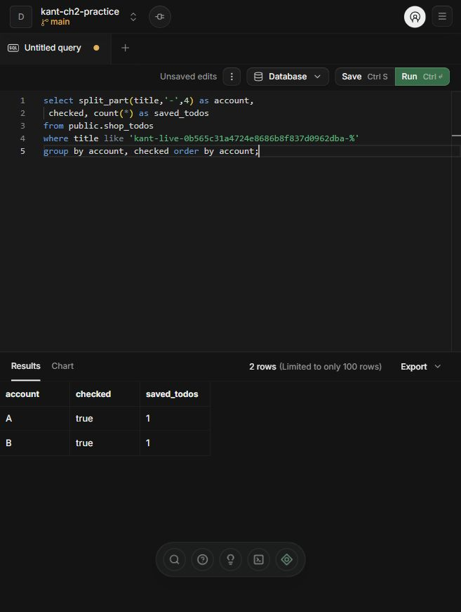
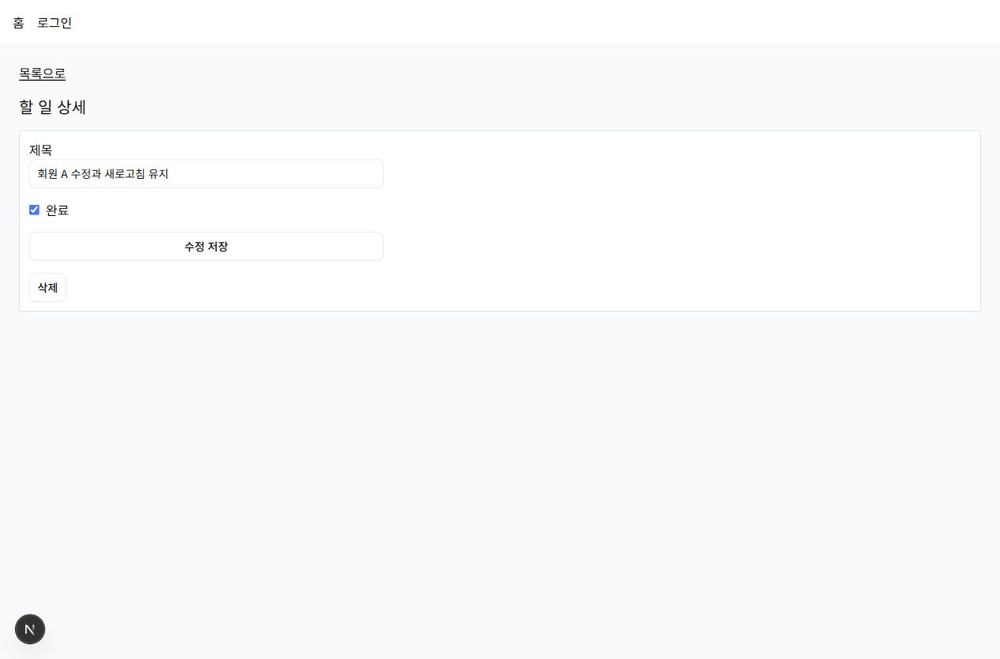
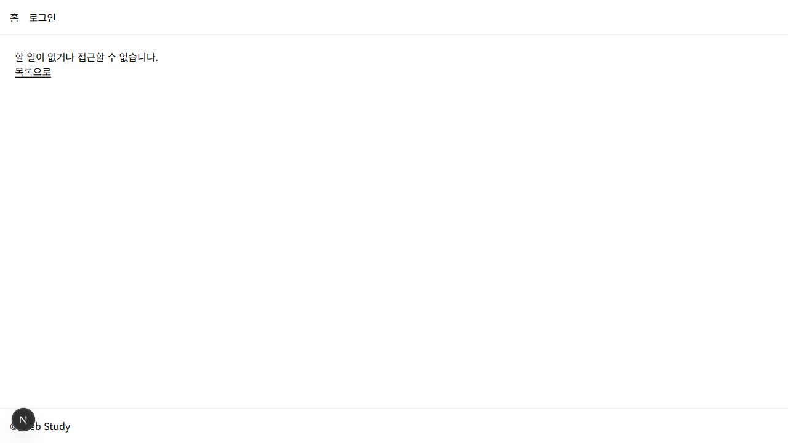
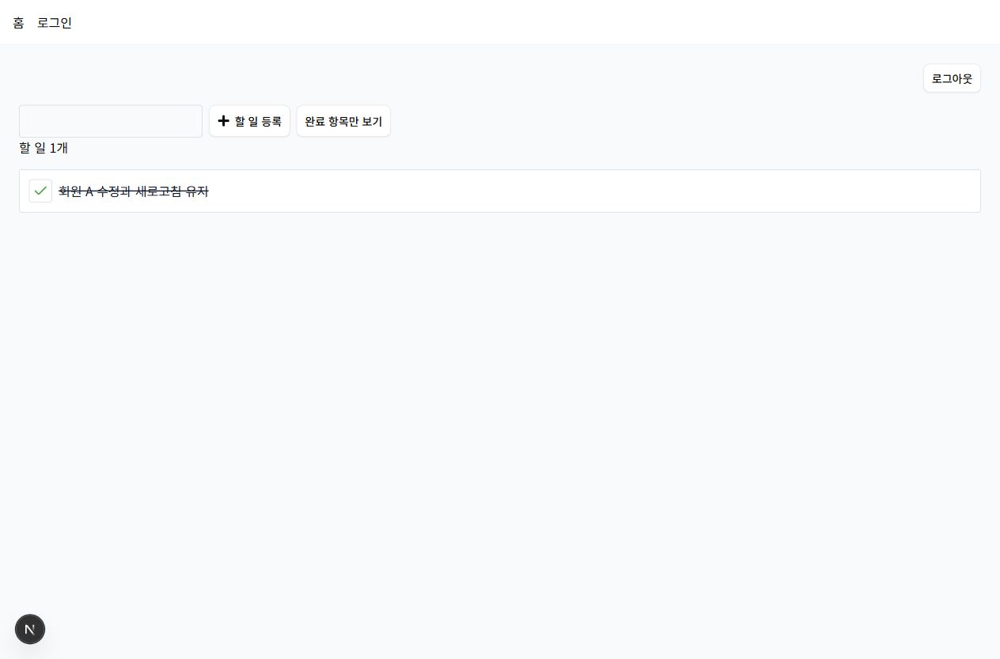
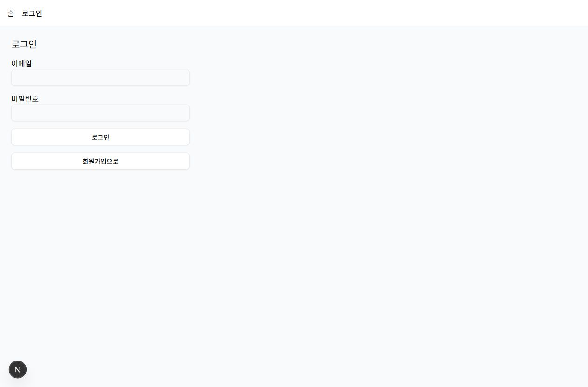

# Next Todo

기존 Todo의 입력, 완료 표시, 필터를 Next.js로 구성하고 Supabase 이메일 회원가입/로그인과 회원별 할 일 저장을 연결한 CH2 과제다. 목록에서 추가와 완료 변경, 상세에서 제목 수정과 삭제를 제공한다.

**검증 상태:** 2026-11-16 lint, 타입 검사, 프로덕션 빌드 통과. 실제 Supabase에서 A/B 로그인, 각 회원의 Todo CRUD, 타인 접근과 소유자 위조 차단을 통과했다. 로컬 Next 화면에서도 추가/수정, 새로고침과 재로그인 후 저장 유지, 회원별 목록/상세 분리, 로그아웃 후 접근 제한을 확인했다. 실제 Vercel 접속 URL은 아직 확인되지 않았다.

## 실행과 환경변수

Node.js와 npm을 준비한다. 의존성은 package-lock.json으로 고정한다.

```sh
npm ci
npm run dev
```

실제 데이터 연결에는 전용 Supabase 프로젝트에 [schema.sql](schema.sql)을 한 번 적용하고 `.env.example`을 `.env.local`로 복사하여 다음 값을 설정한다.

| 변수 | 값 |
| --- | --- |
| NEXT_PUBLIC_SUPABASE_URL | Supabase Project URL |
| NEXT_PUBLIC_SUPABASE_PUBLISHABLE_KEY | Publishable key |

두 변수는 브라우저에서 사용하는 공개 연결값이다. service-role/secret 키와 DB 비밀번호를 넣지 않는다. 데이터 접근 제한은 Supabase Auth와 RLS가 담당한다.

로컬 인증 Redirect URL은 `http://localhost:3000/auth/callback`이다. 이메일 확인이 켜져 있으면 가입 후 확인 링크를 열어야 한다. 설정이 없을 때 로그인 화면은 환경 설정 필요 상태를 표시한다.

## 라우팅과 컴포넌트 설계

| 위치 | 책임 / 전달 데이터 |
| --- | --- |
| app/page.tsx | 서버에서 사용자 확인 후 TodoList에 userId 전달 |
| app/login/page.tsx | 가입/로그인 입력, 처리 중/실패/이메일 확인 안내 |
| TodoList | 목록 조회, 입력, 완료 필터, 등록/완료 변경, 로그아웃 |
| TodoItem | Todo와 onToggle, busy Props로 카드 표현과 이벤트 전달 |
| app/todos/[id]/page.tsx | 서버에서 UUID 형식, 사용자, 소유권 확인 후 상세 조회 |
| TodoDetail | Todo와 userId Props를 받아 제목/완료 상태 수정과 삭제 |
| app/auth/callback/route.ts | 인증 코드를 세션으로 교환한 뒤 목록 이동 |
| proxy.ts | 쿠키 세션 갱신, 개인 응답의 no-store 처리 |

`Todo` 타입은 id, title, checked다. 목록에는 UUID를 key로 사용하므로 필터나 수정으로 배열 위치가 바뀌어도 항목의 정체성을 유지한다. 유효하지 않은 UUID 또는 본인에게 보이지 않는 항목은 not-found로 처리한다.

## Hook과 상태 UI

목록은 useState로 데이터, 입력, 필터, 로딩, 오류, 저장 중 상태를 분리한다. useEffect의 의존성은 userId와 재조회 revision이며, cleanup에서 active를 해제하여 늦게 도착한 응답이 언마운트된 화면의 상태를 갱신하지 않게 한다. 요청 자체를 취소하는 방식은 아니다.

| 상태 | 화면 동작 |
| --- | --- |
| 로딩 | 불러오는 중 표시, 등록 제한 |
| 성공 | 목록과 개수, 등록/수정 성공 메시지 |
| 오류 | role="alert"와 다시 조회 |
| 빈 데이터 | 아직 할 일이 없음 또는 완료 항목 없음 구분 |
| 저장 중 | 중복 조작을 줄이도록 관련 버튼 비활성화 |

현재 목록 조회는 인증 확인 후 브라우저에서 실행한다. 입력과 필터를 같은 클라이언트 상태에서 관리하기 쉽지만 초기 목록 요청이 추가로 필요하다. 상세는 서버에서 필요한 열만 조회한 뒤 편집 UI에 전달한다. 성능 개선 수치를 측정한 것은 아니다.

## 인증과 데이터 보호

`requireUser`는 서버에서 getUser로 인증을 확인한다. 로그인되지 않은 사용자는 /login으로 이동한다. UI의 userId 필터에 더해 DB RLS가 모든 데이터 요청에서 최종 접근을 제한한다.

| shop_todos 컬럼 | 의미 |
| --- | --- |
| id | UUID PK |
| user_id | auth.users.id FK, 회원 삭제 시 연결 행 삭제 |
| title | trim 후 1~200자 |
| checked | 완료 여부, 기본 false |
| created_at | 생성 시각 |

(user_id, created_at) 인덱스는 회원별 목록 조회/정렬을 지원한다. SELECT/DELETE는 본인 행만, INSERT는 본인 ID만, UPDATE는 변경 전후 모두 본인 행만 허용한다. 익명 역할의 테이블 권한은 회수한다.

## 검증

```sh
npm run lint
npm run typecheck
npm run build
```

세 명령은 2026-11-16 실제로 통과했다. 로컬 PGlite에서는 다른 사용자의 행 조회/수정/삭제 차단, 소유자 위조 차단, 익명 접근 차단을 확인했다. 이어서 실제 Supabase Auth/API와 로컬 Next 화면에서 다음 결과를 확인했다.

| 확인 환경 | 동작 | 결과 |
| --- | --- | --- |
| 실제 Supabase Auth | A/B 실습 계정 로그인 | 두 계정 모두 성공 |
| 실제 Supabase API | A/B 각각 Todo 생성, 조회, 제목/완료 수정, 재조회, 삭제 | 모두 통과 |
| 실제 Supabase RLS | A가 B 항목, B가 A 항목을 ID로 직접 조회/수정/삭제 | 6개 검사 모두 빈 결과, 원래 소유자의 데이터 유지 |
| 실제 Supabase RLS | B가 A 소유자로 INSERT, A가 자신의 행을 B 소유자로 UPDATE | 두 요청 모두 `42501` 오류로 거부 |
| 실제 Supabase API | 이번 실행의 테스트 행 정리 | 생성한 ID만 정리, A/B 스크립트 세션 local 로그아웃 성공 |
| 로컬 Next + 실제 Supabase | A 로그인, 할 일 추가, 상세에서 제목/완료 수정, 새로고침 | 저장된 제목과 완료 상태 유지 확인 |
| 로컬 Next 화면 | B 로그인 후 A 목록/상세 접근 차단, B 본인 항목 등록 | A 항목은 보이지 않고 B 항목 1건만 표시, A 상세 직접 접근 시 거부 안내 |
| 로컬 Next 화면 | A 재로그인, 로그아웃 후 A 상세 직접 접근 | A의 완료 항목 1건만 유지, 비로그인 상세 접근은 `/login`으로 이동 |
| 로컬 Next 화면 | 본인 항목의 삭제 버튼 조작 | UI 삭제는 미확인. 위 실제 API 삭제 검증과 구분 |
| 앱 회원가입과 확인 이메일 | 가입 화면부터 이메일 수신/링크 확인까지 | 별도 검증 필요 |
| 실제 Vercel 주소 | 위 사용자 흐름 재확인 | 배포 주소 미확인 |

API 검증과 로컬 Next 화면은 **publishable key + 사용자 로그인 세션**을 사용했다. 서버용 secret 키는 합성 A/B 실습 계정을 준비하는 데만 사용했다. 두 계정은 관리자 API에서 이메일 확인 상태를 지정한 계정이므로, 해당 계정의 로그인 성공을 앱 회원가입이나 확인 이메일 전달 절차의 성공으로 표시하지 않는다.

## 실제 연동 증거

### A/B 저장과 데이터 접근 제한

[실제 Supabase 실행 로그](evidence/live-verification.jsonl)는 2026-11-16 23:19:37~23:21:17 KST에 `wtreqtufnuloqfusshvj.supabase.co`에서 수행한 검증이다. 실행 ID는 `0b565c31a4724e8686b8f837d0962dba`이며 최종 검증/정리 결과는 모두 `PASS`다. 로그에는 같은 실습의 회원/상품/주문 CRUD도 함께 포함되어 있다. Next Todo의 근거는 `auth_login`, `todo_create_read`, `todo_update_read`, `todo_rls`, `todo_delete` 항목이다.

아래 실제 Supabase 화면에서 A/B 실습 항목이 각각 1건, `checked=true`로 저장된 것을 확인했다. 타인 접근 차단은 화면의 집계와 별도로 로그의 `todo_rls` 8개 검사에서 확인했다. 로그에는 인증키, 비밀번호, 세션 토큰을 기록하지 않았다.



### Next 화면의 수정과 새로고침 유지

로컬 Next 개발서버에서 A로 로그인해 할 일을 추가한 뒤 상세 화면에서 제목을 `회원 A 수정과 새로고침 유지`, 완료 상태를 `true`로 저장했다. 같은 상세 URL을 새로고침한 뒤에도 두 값이 유지되었다. 이 UI 검증의 Todo ID는 `e2bec2ba-8ab8-44b0-9033-bd174a9dee15`다.



### Next 화면의 회원별 목록과 상세 분리

B로 로그인한 직후에는 A의 항목이 저장되어 있어도 [빈 목록](evidence/live-ui-b-isolated.jpg)이 표시되었다. B가 `회원 B의 독립된 할 일`을 등록하자 [본인 항목 1건](evidence/live-ui-b-own-todo.jpg)만 표시되었다. 이 B 항목의 ID는 `44eeee9b-c381-4b8a-9c7e-3aa741b8a797`이다.

B 로그인 상태에서 A의 상세 URL `/todos/e2bec2ba-8ab8-44b0-9033-bd174a9dee15`로 직접 이동하면 `할 일이 없거나 접근할 수 없습니다.` 안내가 표시되었다.



A로 다시 로그인하면 수정한 제목과 완료 상태가 유지된 A 항목 1건만 표시되며, B의 항목은 보이지 않는다.



### 로그아웃과 비로그인 접근 제한

A 로그아웃 후 로그인 화면으로 이동했다. 비로그인 상태에서 같은 A 상세 URL에 직접 접근해도 `/login`으로 이동하는 것을 확인했다.



## 배포 주소

현재 확인된 실제 서비스 URL이 없다. GitHub 주소나 localhost 주소를 배포 주소로 대체하지 않는다.

Vercel에는 위 환경변수 두 개를 설정하고, Supabase Site URL은 실제 배포 주소, Redirect URLs는 배포 주소의 /auth/callback으로 맞춘다. 이 저장소의 README 갱신은 Supabase/Vercel 설정이나 실제 배포를 수행하지 않는다.
